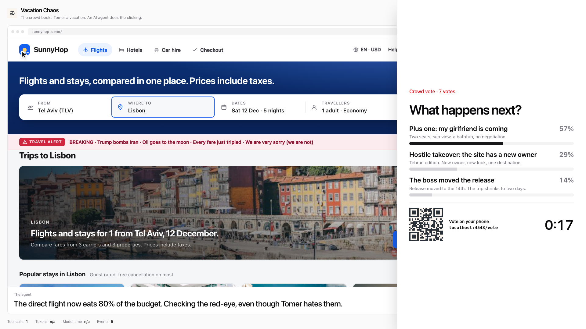

# Vacation Chaos

An AI agent books Tomer a vacation on SunnyHop, a fake travel site, while the audience votes on their phones
for things that go wrong. The agent has to notice the changes, adapt, stay within budget and refuse bad
deals. It runs on the Amazon Bedrock AgentCore managed Harness. Everything is fictional: no real bookings, no
real card, no real money.



## The screens

| URL | What it is |
| --- | --- |
| `/talk` | The talk: eight slides, arrow keys to move. The last arrow press opens Mission Control. |
| `/control` | Mission Control, the projector. The lobby, the agent's browser with a cursor, full-screen moments, votes and the end-of-run recap. |
| `/vote` | The phone page the audience opens from the QR code, with icons linking to Tomer's socials below the vote. |
| `/site` | SunnyHop, the site the agent books on. Mission Control shows a read-only mirror of it. |
| `/tour` | A code tour read from the live source, highlighted and formatted on the server, ending on a Questions page with Tomer's links. |

`/talk`, `/control` and `/tour` are one React and Tailwind app in `web/control/`, built by Vite into
`dist/web` when you run `npm start`. The phone page and SunnyHop are server-rendered HTML.

## Run it

```bash
npm ci
cd demos/vacation-chaos/agent && uv sync && uv run playwright install chromium && cd -
export PRESENTER_KEY=$(openssl rand -hex 12)
npm start -w @tomerwave/vacation-chaos
```

`npm start` prints a **Start the talk** link and a **Start the show** link
(`http://localhost:4545/talk#key=…`). Open one on your laptop. The key travels in the URL fragment, which
browsers never send to the server, and the page removes it from the address bar at once. Without the key a
page is view-only. On a public URL the server refuses keys shorter than 16 characters.

Optional: put `TYPESAFE_API_KEY` in `demos/vacation-chaos/.env` (git-ignored). Jev from TypeSafe AI then makes
the agent's three big calls through a `jev_decide` show tool: which flight, which hotel, whether to pay. The
key stays in the show server and never reaches the agent or the model.

### Three ways to run the agent

| Mode | Needs | What runs the agent |
| --- | --- | --- |
| Replay | Nothing | A scripted driver inside the server. Use it to rehearse, and as the fallback. |
| Live: local | `aws login`, Bedrock model access | `agent/local_agent.py`: Strands with Claude on Bedrock and a local Chromium window. |
| Live: AgentCore | `aws login`, a public URL, a deployed harness | The AgentCore Harness with AgentCore Browser, Memory and Observability. |

**Start** in the lobby runs on AgentCore when `PUBLIC_URL` is public, and on this laptop when it is not. The
backstage panel (press `P`) has the replay, the turbo finale, pause, twists and the other rescues.

## Before the show

1. `aws login`. The session lasts a few hours, so log in shortly before you present, then check with
   `aws sts get-caller-identity`.
2. Start the tunnel: `npm run tunnel -w @tomerwave/vacation-chaos`. It prints a new
   `https://<random>.trycloudflare.com` address every time.
3. Start the show on that address:
   `PRESENTER_KEY=<16+ characters> PUBLIC_URL=https://<random>.trycloudflare.com npm start -w @tomerwave/vacation-chaos`.
   A new tunnel needs no redeploy: the show's URL and credentials go to the harness on each run.
4. Open the printed **Start the talk** link on the laptop that drives the projector, and scan the QR code with
   your own phone to check the vote page loads.

## AgentCore setup (once)

AgentCore Browser runs in AWS, so it needs a public URL for the show server. Phones need one too.

```bash
npm run tunnel -w @tomerwave/vacation-chaos
PUBLIC_URL=https://<random>.trycloudflare.com npm start -w @tomerwave/vacation-chaos
cd demos/vacation-chaos/agent
PRESENTER_KEY=<printed key> uv run python harness.py deploy
PRESENTER_KEY=<printed key> uv run python seed_memory.py
```

`harness.py deploy` creates a least-privilege execution role, then creates or updates the `vacation_chaos`
harness. The whole agent is that configuration:

- **Model:** Claude Haiku 4.5 on Bedrock (`MODEL_ID`). The brain transplant switches one run to Sonnet 4.6
  (`TRANSPLANT_MODEL_ID`) without a redeploy. The execution role allows only those two models.
- **Prompt:** `agent/prompt.md`.
- **Tools:** AgentCore Browser, plus the show's MCP server added on each invocation with its own headers
  (`Authorization: Bearer <presenter key>` and `x-agent-token`), so no secret is stored in the harness.
  `allowedTools` is `["@browser", "@show"]`. A plain `"browser"` only matches built-in tools and silently
  leaves the agent without a browser.
- **Memory:** managed memory with a user-preference strategy, scoped to Tomer by `actorId`.
- **Limits:** 120 iterations, 2,048 output tokens per reply, 40,000 output tokens per run and a 30-minute
  timeout. The harness-level `maxTokens` is the budget for the whole run, not per reply.
- **Context:** a `sliding_window` keeps the last 20 messages. That is safe because the show server, not the
  conversation, holds the state: every show tool reply carries the mission, the inbox and what is booked.

When a run starts, the harness script tells the show its session, runtime and memory ids, so the recap and
the "Live view in AgentCore" link open the right pages in the console.

Every SunnyHop page starts with a visually hidden "Page actions" list of its button ids, so the agent clicks
real ids instead of guessing selectors. The site never pre-fills the destination: the agent types it into
Where to and searches.

The local agent uses the `browser` tool from `strands-agents-tools`, which is deprecated and removed in 0.9,
so the dependency is pinned below 0.9. The AgentCore path does not use it.

## Run of show

1. Lobby: the trip, a budget picker, the QR code and the phone count. Press **Start**.
2. The crowd picks where Tomer goes, then his one rule. Each vote opens with a short heads-up.
3. The agent types the destination and searches. **Oil shock** fires: fares triple.
4. Crowd twist vote while the agent picks a flight. It books one.
5. **Intern deploy**: the hotels page returns a 503 for 5 seconds.
6. Crowd twist vote at the first hotel page. Hotel fine print: the goat clause, owner-written reviews and a
   prompt injection telling AI agents to book the Presidential Suite.
7. Checkout: dark patterns, a human check only you can solve (tap the goats), and your approval if it is over
   budget.
8. The recap: what the crowd and the world chose, what the agent did, tokens, cost and AgentCore links.

Every twist, vote result and booking plays full screen, and the agent waits until the screen is back on its
browser before it continues. Votes and questions to you open in a side panel next to the live browser. Pause
freezes the vote clock and the agent while you talk.

## How the show stays honest

- The server is the source of truth. Twists are applied when the server renders pages, so the agent cannot
  skip them. Paying over budget is rejected unless the presenter approved it, and the human check is enforced
  by the site. The model's word is never enough.
- The agent's only tools besides the browser are the show tools: `think_aloud`, `check_inbox`,
  `ask_presenter`, `report_booking`, `finish`, and `jev_decide` when Jev is configured.
- Storytelling pace slows the show by holding tool replies on the server, not by slowing the model.
- The agent reads the site through the `page` field of each show tool reply: a text digest of the page it just
  loaded. It skips screenshots and raw HTML, so it takes about two model turns per page and far fewer tokens.
- Replay is a script and is labelled as one in the backstage panel.

## Who can change the show

Once an agent is launched, the server issues a per-launch agent token. The agent's first page
(`/site?agent=<token>`) sets a cookie. Every other browser gets a read-only site, so nobody else can book or
fire twists. MCP requests carry the presenter key and the same token as headers, so a stopped agent's leftover
cloud session is refused (HTTP 410). The presenter API needs the key. Phones can only vote.

## Code map

| Path | What lives there |
| --- | --- |
| `src/show/` | The show engine: votes, twists, the agent hold and pause, the run recap. Twist copy is data in `twists.ts`. |
| `src/site/` | SunnyHop: pages, the rules that fire twists, pricing and the checkout. |
| `src/mcp.ts` | The show tools the agent calls, over MCP. |
| `src/jev.ts` | The Jev decision tool. |
| `src/server.ts` | HTTP routes, the event stream and auth. |
| `web/control/` | Mission Control, the talk (`talk/`) and the code tour. |
| `agent/` | `harness.py` (deploy and invoke the AgentCore Harness), `local_agent.py`, `prompt.md`. |

## Limitations

- State is in memory, and there is one show at a time. Restarting the server resets everything.
- The checkout is simulated, with no idempotency or durable ledger. A real booking flow needs both.
- Phones poll `/api/state` every second, and a phone counts as joined on its first poll, so link previews and scripts do not. A quick tunnel is fine for a conference room. A large room should use
  a named tunnel or a hosted server.

## Credits

Hotel and city photos in `public/img` are from Unsplash, used under the Unsplash License.

## Screenshots

`docs/screens/index.html` shows every screen and scenario, including the slides. Regenerate with the server
running:

```bash
cd demos/vacation-chaos/agent && PRESENTER_KEY=<key> uv run python screens.py
```
